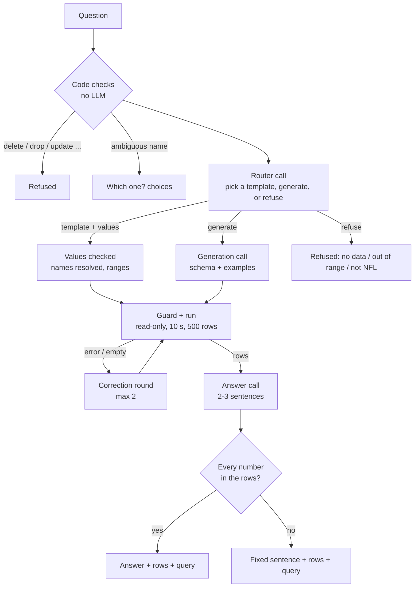

# Ask the Engine guide: questions in plain English

**What this is:** a plain-language guide to Ask the Engine's query layer (AE00): how a question typed in English becomes a query against the weekly knowledge graph or the curated tables, why that goes wrong in general and what this project does about it (templates first, a guard that only lets safe reads through), how the answer's numbers are checked, the golden question set that measures it (and the held-out set that checks it), the model comparison that picked the LLM, the audit that took accuracy from 72% to 95% (88% on new questions), and how to switch models (a local one included). The page in the control room comes in AE01; the history graph in AE02.

**Related docs:** the spec is the [Ask the Engine README](../ask-the-engine/README.md) and the phase file [AE00](../ask-the-engine/AE00-query-layer.md). Decisions: D107 (the no-touch rule), D111 (the model and the safety rules), D136 (the guard as built), D137 (the bake-off rule), D138 (the pick), D139 (the review fixes), D140 (the accuracy audit) in the [decisions log](../10-decisions-log.md). The W&B side is in the [W&B guide §6.11](weights-and-biases.md). Agents use the `ask-the-engine` skill.

---

## 1. Text-to-query, in plain words

The engine's data lives in two places: the **curated tables** (DuckDB over Parquet files: every game since 1999, every play since 2010, box scores, Next Gen Stats, injuries ...) and the **weekly knowledge graph** (Neo4j: players, teams, coaches and games as nodes, with relationships like "threw to", "played for", "worked under"). Both answer questions only in their own languages: SQL for the tables, Cypher for the graph.

"Text-to-query" means an LLM translates the English question into one of those languages, the query runs, and the rows come back. It sounds simple; it goes wrong in three ways:

1. **The query is wrong but runs.** The model joins the wrong tables, forgets that the regular season is `season_type = 'REG'` (not `week <= 18`: seasons before 2021 had 17 weeks), counts sacks as runs, or matches "Dallas" against a column that holds "DAL". The query returns rows, they look plausible, and they're wrong. This is the dangerous case.
2. **The query doesn't run.** A made-up column, a syntax slip. Annoying but safe: the database says so.
3. **The query does something it shouldn't.** Deletes data, reads a file it shouldn't, or runs for an hour.

How good are models at this? On CypherBench (2024) Claude 3.5 Sonnet got 61.6% of graph queries exactly right; small models under 20% (README §2). Free-form generation alone isn't good enough to trust.

**So the design is template-first:**
- A **template** is a query a person wrote and tested, with typed slots ("team", "season", "player"). For a question a template covers, the LLM only *picks* the template and *fills the slots*; the values are checked in code (a team must be one of the 32, a season inside the data) and bound as parameters, never pasted into the text. That removes mistake 1 for those questions.
- Only when no template fits does the LLM **write a query** itself, with the schema of the right source (filtered to the question's words) and the most similar templates as worked examples. Up to two **correction rounds** feed back the database's error or an empty result.
- **Every** query, template or generated, goes through the **guard** (§3), which removes mistake 3 entirely.
- The query and its rows are always shown, so mistake 1 on a generated query is at least visible.

## 2. How a question is answered



The code lives in `src/nflengine/ask/`:

| Module | Job |
|---|---|
| `route.py` | `AskEngine.ask(question)`: the flow above; records everything in an `AskResult` |
| `names.py` | finds the players, coaches and teams a question names, against the curated data (§5) |
| `templates.py` | loads `config/ask_templates.yaml`, checks values, renders a template (§4) |
| `schema.py` | the schema text the generation prompt shows, filtered to the question |
| `guard.py` | the checks, the DuckDB sandbox, timeouts and row caps (§3) |
| `llm.py` | the Ask LLM provider (OpenRouter or a local server), separate from the digest's (§10) |
| `answer.py` | the short answer and its number check (§6) |
| `evaluate.py` | the golden and held-out sets, scoring, the pick rule (§7, §8) |
| `prompts/*.md` | the three prompts (router, generator, answer) |

**A real question, walked through** (2026-10-17, Claude Haiku 5.5 at low effort, a smoke run): *"Which receivers have the most 100-yard games against Dallas since 2020?"*
1. Names: "Dallas" → team `DAL` (no LLM).
2. Router (1.7 s, $0.00016): `{"action": "template", "template": "stat_games_vs_team", "params": {"team": "Dallas", "first_season": 2020}}`.
3. Values checked: team → `DAL`; `first_season` 2020 inside 2010..2026; `last_season` defaults to 2026; `stat` defaults to receiving, which puts the fixed fragment `pg.receiving_yards` into the query; `threshold` defaults to 100.
4. Guard + DuckDB: 32 rows in 0.13 s. A.J. Brown 3 games (best 110 yards), Malik Nabers 2 (167), DK Metcalf 2 (134) ...
5. Answer (1.3 s, $0.00016): *"A.J. Brown leads with 3 hundred-yard receiving games against Dallas since 2020, with a best of 110 yards. Malik Nabers and DK Metcalf follow with 2 games each (best 167 and 134 yards) ..."*. Every number (3, 110, 2, 167, 134, 2020, 100) is in the rows or the question: the check passes.

Total 3.1 s, $0.0003. A question no template covers (*"How does Detroit's play-action do on 3rd down this season?"*) took a generation call too (a join of `plays` and FTN's charting on the play ids): 9.8 s, $0.0011.

## 3. The guard, in plain words

Nothing in `ask/` opens a database session except the guard (`guard.py`: `run_cypher`, `run_sql`, `Sources.run`). Every refusal names the rule it broke in fixed text (`cypher.write`, `sql.table` ...).

### 3.1 The graph (Cypher)

Neo4j Community has **no read-only user** (D112), so the protection is in layers:

1. **A text check** on the query with its strings and comments masked: one statement; no write clause (CREATE, MERGE, SET, DELETE, REMOVE, FOREACH, DROP, INSERT ...); no procedure call (`CALL db.labels()`; the `CALL (x) { ... }` subqueries the library uses are fine); no `LOAD CSV`, `USE`, `SHOW`, `EXPLAIN`, `PROFILE` or `CYPHER` options; no `apoc.`, `gds.`, `dbms.`, `db.` or `genai.` names, and no namespaced function but Neo4j's own (`date.`, `duration.`, `point.` ...); no backtick-quoted names (none are needed, and they could hide a namespace); no client `:` commands; **no `\u` escape anywhere, strings and comments included**, and no other backslash outside strings. Neo4j decodes `\uXXXX` in the whole query before it reads it, so `'' + apoc.version() + ''` is a closed string plus a plugin call to the server, while a checker sees one harmless string (Sol's review found it; the test worker had found the same trick outside strings). A word counts as a clause only where Cypher would read it as one: `n.set` (a property), `:Set` (a label), `{set: 1}` (a map key) and `$create` (a parameter) are fine.
2. **`EXPLAIN` first**, in a READ session: the plan must say query type `r` (read), with no procedure-call or file-reading operator.
3. **The run**: a READ transaction (`execute_read`), a 10-second transaction timeout, at most 500 rows kept. Values must be plain: whole nodes, relationships, paths and maps are refused ("return p.name, not p"), because a node can hold more than the question needs and some carry a property named `key`. The library's own templates may return maps their query builds (`collect({...})`), never nodes.

What the probes found on our Neo4j 5.26 (re-run 2026-10-17, now tests):

| Probe | What happened | Stopped by |
|---|---|---|
| `CREATE`, `MERGE`, `SET` inside a `CALL` subquery, in a READ transaction | rejected by the server (`Neo.ClientError.Statement.AccessMode`) | the server, and the text check first |
| `LOAD CSV FROM 'file:///…'` | plans as a **read**, and the server **tried** the file | the text check |
| `apoc.load.json`, `apoc.export.csv.all`, `gds.graph.project`, `apoc.util.sleep` | all plan as **read** (`ProcedureCall` operators) | the text check (and the plan check) |
| `CALL dbms.listConfig()`, `SHOW USERS` | **run** in READ mode (server settings, user names) | the text check |
| `apoc.coll.sum([1])` (a function) | plans as a plain projection: no operator shows it | the text check |
| a heavy co-appearance MATCH with a 1 s timeout | stopped at ~2.2 s; with 10 s, at 11.3 s | the timeout |

### 3.2 The tables (SQL)

The curated tables are opened in a **sandbox**: an in-memory DuckDB connection that can't touch the file system at all.
- The curated Parquet files come in as **Arrow datasets** registered as views (`plays` is the 17 season files under one schema).
- `enable_external_access = false` from the start, no allowed directories, no extension loading or installing, no temp directory, no scanning Python variables, then `lock_configuration`: no query can change those settings.
- A fresh connection per question, closed at once. `espn_news` (free text) is left out.

Two probes on 2026-10-17 shaped this (D136):
- The README's first design allowed the curated folder (`allowed_directories`). DuckDB treats that as **read and write**: a `COPY (SELECT 1) TO 'curated/x.csv'` landed in the curated folder (deleted at once), and `ATTACH 'curated/nfl.duckdb'` opened the real database read-write. With no allowed directories, both are refused.
- **The Windows file-handle question** (the phase file's): a native `read_parquet` view kept the file open while a query ran, and the curate step's `fsutil.replace_file` failed after its 2-second retry (tested on a copy of `plays/season=2025.parquet` under `cache/`). Arrow opens files with delete sharing: the replace went through mid-query and the query finished correctly. The price: a scan of every season takes ~0.9 s instead of 0.03 s, far inside the 10 s budget.

Then each query is checked by **DuckDB's own parser**, after two lexical checks with DuckDB's tokenizer (which reads no file): the first word must start a SELECT (`SELECT`, `WITH`, `FROM`, `VALUES` ...), and a `;` may only end the query, because DuckDB's parser reads files for `IMPORT DATABASE '<folder>'` before it counts statements, and the parsing then runs on the locked connection; exactly one statement, a `SELECT`; `json_serialize_sql` lists every table and function it names, and the table must be a curated view (or the query's own `WITH` table), table functions only `range`, `generate_series`, `unnest`, and no system or file functions (`duckdb_settings()` would name local paths; `read_parquet`, `glob`, `query()`, `current_setting`, `getvariable` ...). Only the columns the query names are read into memory, file by file, from only the tables it names (a whole-row reference like `to_json(t)`, a positional `#1`, PIVOT, a column-alias list `teams AS t(a, b)` or a `*` needs every column; `*` over `plays`, `player_games` or `team_games` is refused: "name the columns you need"). It runs wrapped in `SELECT * FROM (...) LIMIT 501`, and one 10 s budget covers the checks, the loading (checked between files) and the run, whose timer calls `con.interrupt()` with what's left (a 2.3-billion-row cross join stopped at 10.08 s). The graph side has the same single budget: `EXPLAIN` runs with the timeout, and the run gets what's left.

### 3.3 Before any query: the code checks

- A question over 500 characters, or one that asks to change data ("delete …", "please drop …", "update …"), is refused **in code, before any LLM call** (cost $0).
- An ambiguous name returns the choices, also before any LLM call (§5).
- The router can refuse too: data we don't have (salaries, attendance, college stats, games not played yet), seasons outside the data, not NFL.

### 3.4 What leaves the machine

The LLM sees the question, the resolved names, the template list and the schema; the generator also sees its own failed query and the database's error message (scrubbed: data-root paths made relative, secret-shaped text masked, 400 characters at most); the answer step sees the rows. Nothing else. The API key goes only into the request's header. Database error text is never written to files or W&B: only its type and code.

## 4. The template library

`config/ask_templates.yaml`: 49 templates (34 graph, 15 SQL) in three groups:
- **This week's games** (16; the weekly graph's query library, `graph/queries/*.cypher`, reused as they are with `library:` and `asof: true`): starters out, players facing a former team, injury ripples, QB changes, common opponents, coach reunions, coaching-tree links, former teammates, QB style and play-action matchups, trend and unit mismatches, special teams, officiating, passing-game hubs, usage look-alikes. Each takes an optional team.
- **Graph relationships**: a player's teams by season, a QB's receivers, teammates, a coach's record and tree, a team's rating trend, this week's predictions and injury report, the depth chart, similar players, draft picks, trades ...
- **SQL recipes**: leaderboards, a player's season lines, records, head-to-head, results, team EPA, coaches' records, play-action splits, pass rate over expected, 4th downs, red zone, long plays, N-yard games against a team ...

A template's parts:

```yaml
- id: stat_games_vs_team              # unique, [a-z0-9_]
  source: sql                         # sql | graph
  title: N-yard games against a team
  description: Players with the most games of N+ yards against one opponent ...
  examples: ["Which receivers have the most 100-yard games against Dallas since 2020?"]
  params:
    team: {type: team, description: the opponent}
    first_season: {type: season, min: 2010, default: 2010}
    last_season: {type: season, min: 2010, default: current}
    stat: {type: choice, default: receiving,
           choices: {receiving: pg.receiving_yards, rushing: pg.rushing_yards}}
    threshold: {type: int, min: 1, max: 700, default: 100}
  query: |
    SELECT ... WHERE pg.opponent_team = $team AND {stat} >= $threshold ...
```

Parameter types: `team` (a code, name, nickname or city → the code), `player` (a name → the GSIS id), `coach` (a name → the name as the data spells it), `season` (inside min / max; `current` = this season), `week`, `int`, `float`, `choice` (a list bound as text, or a mapping to **fixed query fragments** substituted for `{name}`: the only text that enters a query, and it comes from this file), `text` (a short bound search string). `filters` narrow a library query that covers every game ("only rows whose `team` or `opponent` is the named team"). `asof: true` binds `$season` / `$week` to the weekly graph's week: the LLM can't move them.

**Adding a template:** write it in the YAML, then check it loads and runs: `uv run python -c "from nflengine.ask.templates import load_templates; print(len(load_templates()))"` and ask its example question with `nfl ask "..." --show-query`. The tests load the real file. Add a golden question for it (§7).

## 5. Names

`names.py` resolves names in Python against the curated data, so the graph needs no search index (the AE00 rule: no new indexes or nodes in the weekly graph):
- **Teams:** codes (only in capitals inside a question: "NO" is New Orleans, "no" is a word), names, nicknames, cities, old names (Oakland → LV, Redskins → WAS), "Bills-Chiefs". "New York" alone is ambiguous.
- **Players:** full names (exact first, in any case: "mike williams" still asks which one; then near misses like "Patrik Mahomes", scored with `rapidfuzz`), and a lone last name only when one prominent player has it ("Mahomes" yes, "Allen" no). Index of 24,854 players with their games, seasons and latest team; loads in 0.7 s.
- **Coaches:** head coaches from the schedules (+ `config/head_coach_fixes.csv`) and coordinators from the coaching seed.

**Ambiguous names return choices, never a guess.** Same-name players count only with 8+ games; if exactly one of them played last season or this one, he's the one ("Josh Allen" is the Bills QB, not the 2014–2016 center); otherwise the question stops with "which one?": "Mike Williams" (three WRs), "Michael Thomas" (the Saints WR and the Bengals DB), "Shanahan" (Kyle or Mike). A name that's both a prominent player and a coach asks too. "Andy Reid" is the coach: his namesake never played.

## 6. The answer and its number check

The answer step gets the question, the query's description, the columns and up to 40 rows, and writes 2–3 sentences. Then, like the digest's `number_provenance` check, **every number in the answer must come from the rows**: a cell's value, or that value rounded (0.2843 → 0.28), or a 0–1 share as a percentage (0.367 → 36.7%), or a number from the question ("since 2020"), the template's values, the row count, or a rank up to the row count ("3rd"). A number written with an explicit sign must also have that sign in the rows ("+0.24" against Detroit's −0.24 fails; "0.24 worse" passes, since the words carry the sign; a dash between numbers, "2020-2025" or "24-17", isn't a sign). If any number fails, the answer is dropped and a fixed sentence points to the table: a wrong number never reaches the reader. There's no second try: the rows and the query are on the page anyway.

## 7. The golden set, and how to add a question

`config/ask_golden.yaml`: 99 questions: 34 a template answers, 26 needing free-form SQL, 24 graph relationships, and 15 trick ones (ambiguous names, requests to change data, seasons outside the data, data we don't have). 84 expect an answer, 11 a refusal, 4 a "which one?". Each answerable question has a **reference query**: hand-written, checked on the real data, and **run again at every eval**, so the expected answer is always the day's (the set doesn't go stale when a new week lands).

```yaml
- id: g001
  question: "Which receivers have the most 100-yard games against Dallas since 2020?"
  category: template          # template | sql | graph | trick
  expect: answer              # answer | refuse | clarify
  source: sql
  template: stat_games_vs_team   # the template a good router picks (scored separately)
  reference: |
    SELECT player_display_name, count(*) AS games FROM player_games ...
  notes: one line on what it checks
```

`$asof_season`, `$asof_week` (the weekly graph's week) and `$current_season` are filled in by the evaluator, for "this week" and "this season" questions.

**How a question is scored** (`evaluate.compare`):
- the system's rows must equal the reference's, **in any order**;
- the system may return **extra columns** (a team next to the player), but every reference column must match one of its columns, and **the row counts must be equal**;
- numbers match at the system column's precision: the reference's true value rounded the way the system rounded its column (0.2843 shown as 0.28 is fine; 14 vs 15, 2,500 vs 2,501 and 0.28 vs 0.29 aren't; nor is 0.4 shown as 0, a rounding that loses every digit), or a 0–1 share written as a percentage (only for references between 0 and 1); text ignores case; lists are compared as sets, and a one-item list counts as its item (`['LAC']` is `LAC`);
- a system column named like one reference column can't stand for a different one (`wins` and `losses` swapped is wrong); otherwise columns are matched by their values, since a template's `coach` may be the subject where the reference's `coach` is the answer;
- refuse questions must be refused; clarify questions must offer every listed choice.

**The conventions every reference (and every query) follows** (written into the schema text and the prompts after the 2026-10-18 audit, §8):
- **playoffs count** unless the question says "regular season" (or "playoffs"): the golden set always worked this way, the models just weren't told;
- **the answer's shape:** one row for a single answer ("who led", "the most"), one row per player / team / coach / game for "which ...", one league-wide row unless a team is named, the top N for "top N";
- **the columns that are the answer:** the people or teams a "which / who" asks for, the numbers a "how many / what was" asks for, labelled in the question's own words ("home" / "road"); supporting numbers are welcome in the system's rows but never required;
- full names (play-by-play's own name columns are abbreviated, "B.Thomas"), a game as its `game_id` plus both teams, two-point tries left out of per-play counts, NGS season figures from NGS's own season rows, teammates only when their roster weeks overlap.

**Adding a question:** write the question as a fan would type it; write the reference so its answer is well defined (no ties at a "top 5" boundary: rephrase as "at least N", or add the tie-break to the question); return the minimal columns (the name and the number asked); run it (`Sources.open().run("sql", "<query>")`) and look at the rows; check the file loads (`load_golden(templates=load_templates())`). Then `nfl ask eval --ids g0NN --no-wandb` to see how the current model does on it.

**The held-out set** (`config/ask_holdout.yaml`, 40 questions, ids g201–g240: 12 template, 11 SQL, 11 graph, 6 trick). The main set was used to find and fix the problems in §8, so a high score on it could just mean the fixes fit those 99 questions. The held-out questions were written afterwards, by a worker who saw the conventions, the templates and the schema but never a model's answer, and nothing has been tuned on them. `nfl ask eval --set holdout` runs them (its own file, `..._holdout.json`, and W&B tag `set:holdout`); `nfl ask pick` never mixes them into the comparison. If the held-out score falls far below the main set's, the fixes didn't generalise. Don't fix the system from a held-out miss: once you do, the set stops being held out.

## 8. Choosing the model, and the accuracy audit

### 8.1 What's measured

`nfl ask eval` puts every golden question through the real path (names, the router, a template or a written query, corrections, the guard, the answer) with one model at one **reasoning effort**, and scores it (§7). The headline number is **execution accuracy**: of the 84 questions that have an answer, the share whose rows equal the reference's. Next to it: the trick questions (refused or "which one?" as they should be), how often a template was used, the time per question (p50, and p95: the slow end) and OpenRouter's billed cost per question.

Reasoning effort is OpenRouter's `reasoning.effort`: at "none" the model answers straight away; at "low" it thinks briefly first; at "xhigh" or "max" it thinks a lot (and needs a 16,000-token reply cap, because OpenRouter sizes the thinking from it). Thinking is billed and takes time, so it only earns its place if it makes the answers better.

### 8.2 The first comparison: 72.6% at best

The first round (2026-10-18; D137's bake-off, then Rishi's changes to it, D138) on the setup as first built:

| Model | Effort | Execution accuracy | $ a question | p95 |
|---|---|---|---|---|
| GPT-6 Luna | max | 72.6% | $0.00106 | 49.7 s |
| GPT-6 Luna | low | 71.4% | $0.00038 | 11.7 s |
| DeepSeek V4.1 Flash 1017 | low | 67.9% | $0.00054 | 9.4 s |
| Claude Haiku 5.5 | low | 66.7% | $0.00113 | 11.2 s |
| Claude Haiku 5.5 | xhigh | 65.5% | $0.00146 | 16.5 s |
| DeepSeek V4.1 Flash 1017 | none | 61.9% | $0.00029 | 2.8 s |
| GPT-6 Luna | none | 60.7% | $0.00031 | 6.3 s |
| Claude Haiku 5.5 | none | 56.0% | $0.00100 | 5.0 s |

(Qwen3.8 Flash was stopped part-way, 26-44 s a question; DeepSeek V4.1 Flash, Mercury 2.5 and GLM 5.3 Flash were dropped by Rishi before they ran.) Rishi: too low, "ideally 85%", and look at the setup before paying for more runs.

### 8.3 The audit: the setup, not the models, cost most of the misses

The 19 questions that nearly every model failed, and then every miss of the best cheap configuration, were read against their reference rows and the queries the models wrote (free: every eval file keeps both tables). When eight different models get the same question wrong, the cause is usually on our side. It was (D140):

- **The schema text misled.** It told models to *skip* Next Gen Stats' season rows ("filter NOT is_season_total"), so every model rebuilt a season from weekly rows and got Aaron Rodgers' time to throw as 2.591 s instead of NGS's 2.592. It put "playoffs 'POST'" next to the games table, which has no such value (its playoff games are 'WC', 'DIV', 'CON', 'SB'), so models wrote `game_type = 'POST'`: the Chiefs' record in close games came out 21-12 instead of 26-13, and "which teams made the playoffs every year" found none.
- **Rules nobody had written down.** Do playoffs count? (Yes, unless the question says regular season: the golden set always assumed that, the models were never told.) Is "who led the league" one row or a top-10 list? Are "which players" one row per player or per game? Which name column is the full name? (Play-by-play's own name columns are abbreviated: "B.Thomas".) How do you know two players were teammates? (Their roster weeks overlap; the graph has that property, but the schema text didn't list it.)
- **Three templates answered a slightly different question.** "Who has caught the most passes from Matthew Stafford since 2018?" picked the template that ranks a quarterback's receivers by *targets*, so it said Puka Nacua (380 catches); Cooper Kupp has 384. "Which current Buccaneers played with Saquon Barkley on the Giants?" also listed his Eagles teammates. "Kyle Shanahan's record from 2018 to 2025" included 2026. The templates now take the measure to rank by, the former team, and a season range.
- **Two data traps.** The officials table changed its ids in 2023, so 108 officials have two ids and counting by id splits their games (Carl Cheffers' 15 Chiefs games came out as 11). And the schedule's head-coach names are nflverse's, which still listed Raheem Morris as Atlanta's 2026 coach (it's Kevin Stefanski): the graph had always applied the project's corrections, the SQL side hadn't. It does now, when it loads the table.
- **The scoring was too strict in ten places.** Some references asked for more than the question did (a "pushes" column for "how many went over, and how many under?", a `game_id` for "what was the most points a team scored?"), one used "away" where the question said "on the road", two broke the rules above (ties in an average margin of *victory*; two-point tries counted as QB sneaks). Each was corrected, with the reason in the question's notes, and no other reference changed. A one-item list (`['LAC']`) now counts as its item.

The same model, GPT-6 Luna at "low", through the fixes:

| Step | Main set | Held-out set |
|---|---|---|
| The first setup | 71.4% ([`clswkr61`](https://wandb.ai/models-ontario-tech-university/nfl-analytics-engine/runs/clswkr61)) | |
| + the ten corrected references (re-scored, no new run) | 78.6% | |
| + the written-down rules and the three templates | 90.5% ([`r1hj9ae0`](https://wandb.ai/models-ontario-tech-university/nfl-analytics-engine/runs/r1hj9ae0)) | |
| + the coach and officials fixes, the scorer's one-item lists | **95.2%** on its first run, **92.1%** over three ([`5xe7wf5h`](https://wandb.ai/models-ontario-tech-university/nfl-analytics-engine/runs/5xe7wf5h), [`b0phzp4j`](https://wandb.ai/models-ontario-tech-university/nfl-analytics-engine/runs/b0phzp4j), [`tsii5kpq`](https://wandb.ai/models-ontario-tech-university/nfl-analytics-engine/runs/tsii5kpq)) | **88.2%**, then 91.2% (mean 89.7%; [`su29uxna`](https://wandb.ai/models-ontario-tech-university/nfl-analytics-engine/runs/su29uxna), [`99ep48qe`](https://wandb.ai/models-ontario-tech-university/nfl-analytics-engine/runs/99ep48qe)) |

**Was that just fitting the 99 questions?** That's what the held-out set is for (§7): 40 new questions written after the fixes, by someone who never saw a model's answer, and never used to tune anything. 88.2% there (91.2% on a second run) means the fixes carry over. The main set's number is the more flattering one, because its questions shaped the fixes.

### 8.4 The final comparison: every model at its highest effort

Rishi asked to try the highest reasoning effort ("Low or none I think can be degrading the model"), so the final round ran each model at "max", with Luna at "low" as the cheap baseline, on both sets:

| Model | Effort | Main set | Held-out set | $ a question | p95 (main) | W&B (main / held-out) |
|---|---|---|---|---|---|---|
| GPT-6 Luna (the rule's pick) | low | 95.2% (92.1% over 3 runs) | 88.2% (89.7% over 2) | $0.00034 | 11.0 s | [`5xe7wf5h`](https://wandb.ai/models-ontario-tech-university/nfl-analytics-engine/runs/5xe7wf5h) / [`su29uxna`](https://wandb.ai/models-ontario-tech-university/nfl-analytics-engine/runs/su29uxna) |
| **DeepSeek V4.1 Flash 1017** (in use, D141) | **max** | 94.0%, then 96.4% (mean 95.2%) | 88.2% | $0.00108-0.00179 | 27.0-38.5 s | [`01fa26yj`](https://wandb.ai/models-ontario-tech-university/nfl-analytics-engine/runs/01fa26yj), [`yvefej2p`](https://wandb.ai/models-ontario-tech-university/nfl-analytics-engine/runs/yvefej2p) / [`bz4w3w0r`](https://wandb.ai/models-ontario-tech-university/nfl-analytics-engine/runs/bz4w3w0r) |
| Claude Haiku 5.5 | max | 94.0% | 88.2% | $0.00398 | 81.5 s | [`i6ml8nyo`](https://wandb.ai/models-ontario-tech-university/nfl-analytics-engine/runs/i6ml8nyo) / [`9io2690j`](https://wandb.ai/models-ontario-tech-university/nfl-analytics-engine/runs/9io2690j) |
| GPT-6 Luna | max | 92.9% | 85.3% | $0.00094 | 61.0 s | [`0ujoyxne`](https://wandb.ai/models-ontario-tech-university/nfl-analytics-engine/runs/0ujoyxne) / [`u40ieanj`](https://wandb.ai/models-ontario-tech-university/nfl-analytics-engine/runs/u40ieanj) |

**One run is not the whole story.** The same model on the same questions doesn't give the same score twice: Luna at "low" scored 95.2%, 90.5% and 90.5% on three runs of the main set (mean 92.1%) and 88.2% and 91.2% on the held-out set (mean 89.7%). A handful of questions flip from run to run (a template's seasons left unset, an unnecessary refusal, a missing name column), so one run moves by about ±3 points, and the single-run differences in the table are inside that noise. Compare configurations over repeat runs, and quote the mean.

GPT-6.1 Sol at "max" was measured on 5 questions ([`tnkh0zbn`](https://wandb.ai/models-ontario-tech-university/nfl-analytics-engine/runs/tnkh0zbn)): $0.042 a question and about 73 s each, roughly 120 times Luna's cost. Both sets would have cost about $5.90 with $2.84 of the $5 budget left, so Rishi skipped it, and decided the cheap model stays the default even if a frontier model scored higher.

### 8.5 The model in use: DeepSeek V4.1 Flash 1017 at "max"

**The rule's pick** (Rishi's rule, D138): the best execution accuracy whatever it costs; results within 2 points (one question of 84) count as a tie, and a tie goes to the cheapest, then the fastest. With ±3 points of run-to-run noise nothing separates the four, so the rule picks the cheapest: Luna at "low".

**Rishi's choice** (D141): DeepSeek V4.1 Flash 1017 at "max", because at "low" a small model barely reasons, and a stronger reasoner is the safer bet for questions that need real database work. On the numbers it's at least as good: **94.0% and 96.4% on two runs of the main set (mean 95.2%)** against Luna's 92.1%, and 88.2% held-out against Luna's 89.7% (a second held-out run stopped when OpenRouter ran out of credits; Rishi called the choice final without re-running it). It costs $0.0011-0.0018 a question (3-5 times Luna's, about $1-2 per thousand questions); a typical question takes about as long (p50 5-7 s), slow ones longer (p95 27-39 s against 11-13 s). So `ask.llm` is `deepseek/deepseek-v4.1-flash-1017` at `max`, with a 16,000-token reply cap and a 120 s timeout per call. `nfl ask pick` still prints the rule's pick and says when `ask.llm` was set by hand.

**Two endpoint quirks** came up while switching. OpenRouter sends a request to the model's fastest endpoint at that moment, and endpoints of the same model don't all behave alike: one (Parasail) wrapped single values in a list (`{"action": ["template"]}`), which made every routing step fail until the reply parser learned to unwrap it; and at "max" an endpoint now and then sends an empty reply (all its budget spent on thinking), which is now asked for once more. Both are in `llm.py`, with tests.

**What we learned about effort:** on the first setup "max" bought Luna one question; on the fixed setup it bought nothing and cost three times as much and five times the wait. Once the instructions were right, every model landed within about one question of the others. The accuracy was in the setup.

### 8.6 What still goes wrong

On the main set, the four misses are the model's: "which defense blitzed most often" answered with a count of blitzes instead of a rate; "how often did teams convert on 4th-and-1" answered team by team instead of league-wide; a matchup question answered without the game's id; a "faces the team that drafted him" question answered from projections instead of rosters. On the held-out set, the misses were a question about broken tackles refused even though PFR's tables have them, an injury count filtered wrongly (0 instead of 31), traded draft picks listed instead of the players, and a "less than a 40% chance" question answered with every game (the predictions template has no threshold). They're written down, not fixed: fixing the system from held-out misses would make the held-out set worthless as a check.

### 8.7 Running it again

`nfl ask eval --candidates` runs every configuration in `ask.candidates` (the four above) on the main set, `nfl ask eval --candidates --set holdout` on the held-out set, and `nfl ask pick` applies the rule to the main set (it compares only runs made with today's prompts, schema text, templates and golden set: g055 was reworded after Sol's second review, so today it lists the Luna repeat runs only; re-run the other three to see them again). Prices and models change: re-run before switching, and compare held-out numbers only with each other. AE00's OpenRouter spend, everything included: about $2.16.

## 9. Commands

```bash
uv run nfl ask "Which receivers have the most 100-yard games against Dallas since 2020?"
```

| Command | What it does |
|---|---|
| `nfl ask "<question>" [--source graph\|sql\|auto] [--show-query] [--model <id>] [--json]` | One question: the answer, the rows (first 15), the source and its date, the route (template or generated), corrections, time, cost; the query with `--show-query`. Exit 0, 2 on an error, 3 out of OpenRouter credits |
| `nfl ask eval --model <id> [--effort none\|low\|xhigh\|max] [--max-tokens N] [--llm-timeout S] [--set main\|holdout] [--n N] [--ids g001,g002] [--no-wandb] [--smoke]` | The golden set (or, with `--set holdout`, the held-out set) with one model: one line per question, the summary, a file in `ask/evals/` and a W&B `ask-eval` run. A high effort needs `--max-tokens 16000 --llm-timeout 120` (OpenRouter sizes the reasoning budget from the reply cap). Exit 3 when OpenRouter runs out of credits (refill, then run it again) |
| `nfl ask eval --candidates [--effort low]` | Every candidate in `settings.yaml` (`ask.candidates`), at each of its efforts, with its own `max_tokens` / `timeout_s` if it has them, one after the other |
| `nfl ask pick [--rescore]` | The comparison table from the newest complete run of each model and effort (made with today's prompts, golden set and templates), and the pick by Rishi's rule (D138: the best execution accuracy; within 2 points, the cheaper, then the faster). `--rescore` first re-scores runs saved by an older scorer from their stored tables |

## 10. Switching the model

The model is `ask.llm.model` in `config/settings.yaml` (with `reasoning_effort`, and for a high effort `max_tokens` 16000 and `timeout_s` 120); the digest's `llm:` block is a different block and isn't touched. Today: DeepSeek V4.1 Flash 1017 at "max" (§8.5).

- **When a model that worked starts failing:** look at the `provider` of its calls (`nfl ask "..." --json`). OpenRouter routes to the fastest endpoint of the moment, and endpoints differ (§8.5); `ask.llm.openrouter` takes OpenRouter's provider options (`order`, `ignore`, `allow_fallbacks`) to pin or skip one.

- **Another OpenRouter model:** put its id in `ask.llm.model` (any id from openrouter.ai/models), then run `nfl ask eval --model <id>` (and `--set holdout`) and compare it with §8.4 in W&B (`nfl ask pick` includes it). Prices and latencies change: re-run the eval before switching.
- **A local model** (AE04, or any server that speaks the OpenAI chat API: vLLM, llama.cpp's server, Ollama ...): set `ask.llm.provider: openai_compatible`, put the server's address in the env file as `LLM_BASE_URL` (it must be `https://`, or `http://localhost` / `127.0.0.1`) and, if it wants one, `LLM_API_KEY` (Rishi edits the env file; `nfl doctor` shows whether they're set). Set `ask.llm.model` to the server's model name, and `price_in_per_m` / `price_out_per_m` if you want costs logged. Then `nfl ask eval --model <name>`.

## 11. Files

| What | Where |
|---|---|
| Code | `src/nflengine/ask/` (+ the `nfl ask` group at the end of `src/nflengine/cli.py`) |
| Prompts | `src/nflengine/ask/prompts/route.md`, `generate.md`, `answer.md` (their hash is logged with every eval) |
| Templates | `config/ask_templates.yaml` |
| Golden set | `config/ask_golden.yaml` |
| Settings | `config/settings.yaml` → `ask:` |
| Eval results | `{NFL_DATA_ROOT}/ask/evals/<UTC stamp>_<model>_<effort>.json` (every question's route, outcome, time, cost, query and answer; no keys) |
| Tests | `tests/ask/test_ask_*.py` (the live probes: `uv run pytest -m integration tests/ask`) |

## 12. Changing it safely

- **A prompt:** edit the `.md` file, run `uv run pytest tests/ask`, then `nfl ask eval` with the chosen model: the new prompt hash shows in the run's config, so W&B tells the runs apart.
- **The guard:** never loosen a rule without a red-team test for what it now lets through; the live probes (`-m integration`) must still pass.
- **The weekly graph:** Ask only reads it (D107). Never add an index or node for Ask; resolve names in Python.

## 13. Limits and what's next

- A generated query can be **wrong but plausible** (§1): the query and rows are always shown for that reason, and the golden set measures how often.
- The weekly graph is a **snapshot as of one week** (results before week W): questions about older seasons' multi-hop details work only from 2018, and "this week" means the graph's week.
- Play-level relationships (who was on the field together) need the **history graph** (AE02); six-degrees connections come in AE03; a local fine-tuned model is AE04's experiment.
- **AE01** puts this behind Explore → Ask the Engine in the control room, with its own safety review of the free-text endpoint.
